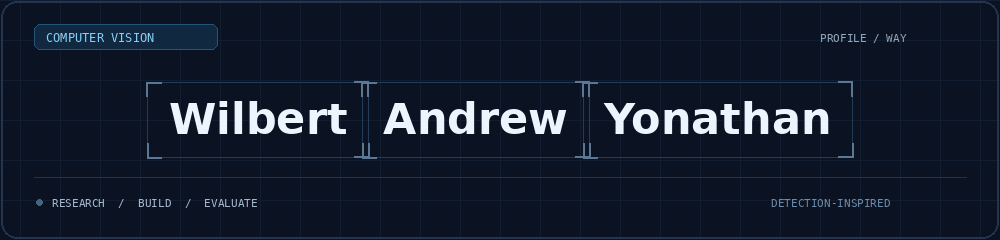

  

  

  <strong>Final-year AI Engineering student · Xiamen University Malaysia</strong> 
  Building practical AI applications through research and engineering.

  
  
  
  

## About me

I build **computer vision, efficient deep learning, and RAG-powered AI applications**. I enjoy developing and evaluating neural networks, working with visual data, and turning research prototypes into interactive applications using Python, PyTorch, OpenCV, and YOLO.

My work covers **object detection, image classification, visual anomaly inspection, retrieval-augmented generation, and reinforcement learning**. I also work across data preparation, model evaluation, backend integration, and cloud deployment, with an emphasis on reproducible experiments and clear reporting of model limitations.

- **Education:** Bachelor of Engineering in Artificial Intelligence, Xiamen University Malaysia (**September 2023–September 2027, expected**).
- **Academic record:** CGPA **3.77 / 4.00** · Dean’s List for **three consecutive semesters** · XMUM Merit Scholarship for the four-year undergraduate programme (**2023–2027**).
- **Internship availability:** **29 March 2027**, for **3–5 months**.
- **Open to:** AI/ML and Computer Vision internships, plus part-time and project-based collaboration, subject to availability and work authorisation.

## Featured projects

### PaddyLiteX · Paddy disease detection · Final-year thesis

Developed a PyTorch-based YOLOv8n detector using a **DenseLiteX backbone, SPPF and C2PSA** for nine paddy disease and health classes, achieving **81.67% mAP@0.5 on 803 test images**.

Compared with the **initial YOLOv8n-DenseNet121 proposal**, the final architecture reduced parameters by **68.01%** and GFLOPs by **72.59%**. I conducted ablation studies and deployed a three-model interactive comparison demo.

Python · PyTorch · Ultralytics YOLO · OpenCV 
[Repository](https://github.com/WAYTECHG/PaddyLiteX) · [Live demo](https://paddylitex.onrender.com/)

### DefectRAG · Visual anomaly inspection & evidence-grounded RAG

Built a visual inspection application for **12 VisA product categories** using a frozen **DINOv2** encoder, normal-reference comparisons, calibrated anomaly scores, and heatmaps. The project reports **95.13% mean image AUROC** in a *retrospective development evaluation*, not an independent external validation.

Integrated **BGE embeddings, LangChain, LangGraph, and Qwen** for cited RAG explanations. Developed a **React.js/FastAPI dashboard** for inspection history, reports and review workflows, using **Supabase (PostgreSQL)** for cloud collaboration, **SQLite** locally, and **Hugging Face ZeroGPU** for queued cloud inference.

Python · PyTorch · DINOv2 · LangChain · LangGraph · Qwen · React.js · FastAPI · Supabase · SQLite 
[Repository](https://github.com/WAYTECHG/DefectRAG) · [Live demo (Hugging Face Spaces)](https://huggingface.co/spaces/Wizzas/DefectRAG)

### MarineLite · Marine organism detection

Integrated **GhostConv and SimSPPF into DU-MobileYOLO** on URPC2020, increasing mAP@0.5 from **74.23% to 75.36%** while reducing parameters from **4.70M to 4.37M**.

I evaluated accuracy–complexity trade-offs through baseline and ablation experiments and deployed an interactive demo with bounding-box visualisation and model comparisons. The repository credits the original DU-MobileYOLO work.

Python · PyTorch · YOLO · OpenCV 
[Repository](https://github.com/WAYTECHG/GhostConv-and-SimSPPF-Integration-for-Marine-Organism-Detection) · [Live demo](https://marine-object-detection.onrender.com/)

### dPickleball · Autonomous reinforcement learning agent

Trained **Proximal Policy Optimization (PPO)** agents in Unity ML-Agents using a two-stage pipeline combining a six-level wall-training curriculum with league self-play. I experimented with reward and penalty configurations to develop movement, paddle rotation and ball-return behaviour.

Contributed candidate policies and round-robin evaluation to a **six-member team that placed 2nd among 13 teams in the final class competition**. The project builds on the [original dPickleBall environment](https://github.com/dPickleball/dPickleBallEnv).

Python · PyTorch · Unity ML-Agents · PPO 
[Repository](https://github.com/WAYTECHG/dpickleball-reinforcement-learning-agent) · [Watch the competition on YouTube](https://www.youtube.com/live/CitFn9FK12s)

### FER2013 · Facial expression recognition

Contributed **custom CNN development and evaluation, VGG16 fine-tuning and evaluation, and the main application code** to a team project classifying seven facial expressions. The custom CNN achieved **66.00% reported test accuracy** in the project evaluation.

The project also includes a browser demo for image uploads and webcam inference, with face detection, confidence scores and model switching.

Python · TensorFlow/Keras · OpenCV · scikit-learn · ONNX Runtime Web 
[Repository](https://github.com/WAYTECHG/FER2013-Project) · [Live demo](https://fer2013-project.onrender.com/)

## Technical skills

**Programming**

**Machine learning & data**

**Generative AI & NLP**

**Web & APIs**

**Databases**

**Development & deployment**

**Application services**

**Reinforcement learning**

Curriculum learning · Reward shaping · League self-play · Policy evaluation

**Evaluation:** Dataset preparation, baseline comparisons, ablation studies, image AUROC, precision/recall and mAP.

## GitHub activity

  
  

  

<!-- Generated from my contributions by .github/workflows/snake.yml. -->

  <picture>
    <source media="(prefers-color-scheme: dark)" srcset="https://raw.githubusercontent.com/WAYTECHG/WAYTECHG/output/github-snake-dark.svg">
    <source media="(prefers-color-scheme: light)" srcset="https://raw.githubusercontent.com/WAYTECHG/WAYTECHG/output/github-snake.svg">
    
  </picture>

## Experience & leadership

- **Student Registration & Operations Assistant, Xiamen University Malaysia (April 2025):** Supported registration and event logistics with a team serving **800+ students**.
- **Head of Photography & Videography, Love in Action (February–March 2026):** Coordinated media coverage and edited outreach materials.
- **Head of General Affairs, XMUM AI Club (April–October 2025):** Coordinated logistics and external partners for a national-level AI event.

**Languages:** English, Mandarin, Indonesian, Malay and Hokkien.

## Let’s connect

Looking for someone to contribute to **computer vision, efficient deep learning, or RAG-powered AI applications**? Explore my [portfolio](https://wilbert-andrew-yonathan.vercel.app/), connect on [LinkedIn](https://www.linkedin.com/in/wilbert-andrew-yonathan-85562326a/), or [email me](mailto:wilbertyonathan@gmail.com).
