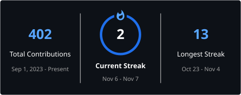

  

  <a href="https://wilbert-andrew-yonathan.vercel.app/">Portfolio</a> ·
  <a href="https://www.linkedin.com/in/wilbert-andrew-yonathan/">LinkedIn</a> ·
  <a href="https://huggingface.co/Wizzas">Hugging Face</a> ·
  <a href="mailto:wilbertyonathan@gmail.com">Email</a>

---

## About

I build **computer vision, generative AI and efficient deep learning applications**: training and evaluating models, then turning them into working demos with a backend and a deployed UI. I care about reproducible experiments and honest reporting of model limitations.

| | |
|---|---|
| **Education** | B.Eng. Artificial Intelligence, Xiamen University Malaysia (Sep 2023 – Sep 2027, expected) |
| **Academic record** | CGPA **3.77 / 4.00** · Dean's List, 3 consecutive semesters · XMUM Merit Scholarship (2023–2027) |
| **Looking for** | AI/ML internship (computer vision, deep learning, generative AI) · **3–5 months from 29 March 2027** · also open to project-based collaboration |
| **Spoken languages** | English (Professional Working), Mandarin (Conversational), Malay (Conversational), Indonesian (Native), Hokkien (Native) |

## Featured projects

*Render-hosted demos can take about a minute to wake on first load.*

| Project | What it does | Key result | Links |
|---|---|---|---|
| **PaddyLiteX** *Final-year thesis* | Lightweight YOLOv8n paddy disease detector (DenseLiteX backbone, SPPF, C2PSA), 9 classes | **81.67% mAP@0.5** on 803 test images; **−68.01% params, −72.59% GFLOPs** vs. the initial YOLOv8n-DenseNet121 proposal | [Code](https://github.com/WAYTECHG/paddylitex-disease-detection) · [Demo](https://paddylitex.onrender.com/) · [HF Space](https://huggingface.co/spaces/Wizzas/PaddyLiteX) |
| **DefectRAG** | Visual anomaly inspection across 12 VisA categories (partly fine-tuned DINOv2 + coreset memory + heatmaps) with cited RAG explanations from a QLoRA-fine-tuned Qwen2.5-3B and a review dashboard | **0.971 mean image AUROC** on VisA (0.950 before fine-tuning and coreset memory), **0.992** on MVTec AD; VisA figures are descriptive, not independent validation | [Code](https://github.com/WAYTECHG/DefectRAG) · [Demo](https://huggingface.co/spaces/Wizzas/DefectRAG) |
| **MarineLite** | Marine organism detection: GhostConv + SimSPPF integrated into DU-MobileYOLO on URPC2020 | mAP@0.5 **74.23% → 75.36%**, params **4.70M → 4.37M** | [Code](https://github.com/WAYTECHG/marinelite-organism-detection) · [Demo](https://marine-object-detection.onrender.com/) |
| **dPickleball** | PPO agents in Unity ML-Agents: 6-level wall-training curriculum, then league self-play | Team placed **2nd of 13** in the class competition | [Code](https://github.com/WAYTECHG/dpickleball-rl-agent) · [Video](https://www.youtube.com/live/CitFn9FK12s) |

<strong>Project details, stacks and my contribution</strong>

 

**PaddyLiteX** · Python, PyTorch, Ultralytics YOLO, OpenCV
Ran ablation studies and deployed an interactive three-model comparison demo.

**DefectRAG** · Python, PyTorch, DINOv2, QLoRA, LangChain, LangGraph, Qwen, BGE embeddings, React.js, FastAPI, Supabase (PostgreSQL), SQLite, n8n, AWS Lightsail, GitHub Actions, pytest, Hugging Face ZeroGPU
Detector: DINOv2 with its last four blocks fine-tuned on synthetic defects and a coreset memory of normal patches; assistant: BGE retrieval, LangChain and LangGraph with a Qwen2.5-3B fine-tuned with QLoRA (correct quoted sources 42% → 89% on 100 held-out questions). Dashboard with inspection history, reports and review workflows; Supabase (Auth, row-level security, TOTP MFA) for cloud collaboration, SQLite locally, ZeroGPU for queued cloud inference; corrective-action emails via n8n self-hosted on AWS Lightsail. 500+ automated tests (284 frontend, 226 backend) run in GitHub Actions CI, and releases to Hugging Face go through an approval step.

**MarineLite** · Python, PyTorch, YOLO, OpenCV
Baseline and ablation experiments on the accuracy–complexity trade-off; demo with bounding-box visualisation and model comparison. The repository credits the original DU-MobileYOLO work.

**dPickleball** · Python, PyTorch, Unity ML-Agents, PPO
Experimented with reward and penalty configurations for movement, paddle rotation and ball return. My contribution: an independent PPO agent (reward and penalty settings, about 90 minutes per run, 4 checkpoints delivered to the team); my candidate reached the top 4 of the team's round-robin. Built on the [original dPickleBall environment](https://github.com/dPickleball/dPickleBallEnv).

## Tech stack

| | |
|---|---|
| **Languages** |      |
| **ML & Computer vision** |        |
| **GenAI & NLP** |      |
| **Data** |      |
| **Web & APIs** |      |
| **Cloud & Deployment** |             |
| **Tools & Automation** |      |

**Focus areas:** object detection · image classification · visual anomaly detection · generative AI (RAG, LLM fine-tuning) · reinforcement learning (PPO, curriculum learning, reward shaping, league self-play)  
**AWS used:** Lightsail, Lambda, CloudWatch, SNS, IAM, Budgets  
**Evaluation:** dataset preparation, baselines, ablation studies, image AUROC, precision/recall, mAP

## Experience & leadership

- **Head of Photography & Videography**, Love in Action (Feb – Mar 2026): scheduled 8 departments' filming; managed and co-edited 200+ clips for a 150+ participant final video.
- **Head of General Affairs**, XMUM AI Club (Apr – Oct 2025): managed RM1,000 WPS sponsorship on 5+ event items; booked venues for a national AI tournament.
- **Student Registration & Operations Assistant**, Xiamen University Malaysia (Apr 2025): assisted registration logistics and directed students within a team serving 800+ foundation students.

  

<!-- Generated from my contributions by .github/workflows/snake.yml. -->

  <picture>
    <source media="(prefers-color-scheme: dark)" srcset="https://raw.githubusercontent.com/WAYTECHG/WAYTECHG/output/github-snake-dark.svg">
    <source media="(prefers-color-scheme: light)" srcset="https://raw.githubusercontent.com/WAYTECHG/WAYTECHG/output/github-snake.svg">
    
  </picture>

## Contact

Hiring for **computer vision, generative AI or efficient deep learning**? Reach me at [wilbertyonathan@gmail.com](mailto:wilbertyonathan@gmail.com) or on [LinkedIn](https://www.linkedin.com/in/wilbert-andrew-yonathan/).
